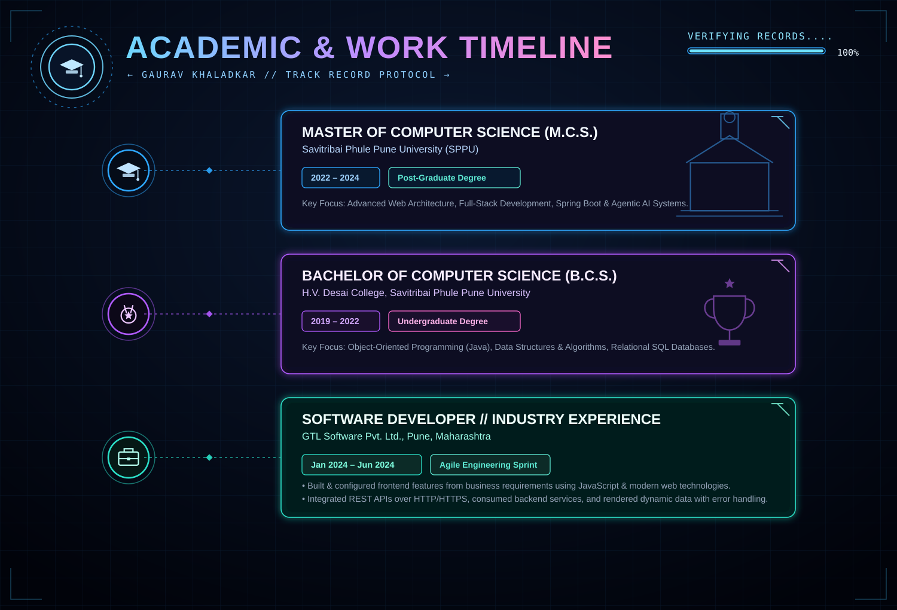

<!-- ═══════════════════════════════════════════════════════════════════ -->
<!-- ██          GLACIER.OS DYNAMIC HERO SECTION                      ██ -->
<!-- ═══════════════════════════════════════════════════════════════════ -->

 

<!-- ══════════════ GLACIER LINK BADGES ══════════════ -->

&nbsp;
&nbsp;
&nbsp;

  

&nbsp;

<!-- ═══════════════════════════════════════════════════════════════════ -->
<!-- ██               ANIMATED NEON DIVIDER                          ██ -->
<!-- ═══════════════════════════════════════════════════════════════════ -->

<!-- ═══════════════════════════════════════════════════════════════════ -->
<!-- ██              TECH STACK — FUTURISTIC ARSENAL                  ██ -->
<!-- ═══════════════════════════════════════════════════════════════════ -->

<!-- ═══════════════════════════════════════════════════════════════════ -->
<!-- ██       FULL-STACK & AGENTIC AI — ARCHITECTURE MAP              ██ -->
<!-- ═══════════════════════════════════════════════════════════════════ -->

<!-- ═══════════════════════════════════════════════════════════════════ -->
<!-- ██              PROJECTS — MISSION CONTROL DASHBOARD             ██ -->
<!-- ═══════════════════════════════════════════════════════════════════ -->

<!-- ═══════════════════════════════════════════════════════════════════ -->
<!-- ██              CERTIFICATIONS — VERIFIED CLEARANCES             ██ -->
<!-- ═══════════════════════════════════════════════════════════════════ -->

 

  

 

  &nbsp;
  &nbsp;
  
    
  &nbsp;
  &nbsp;
  

 

<!-- ═══════════════════════════════════════════════════════════════════ -->
<!-- ██                EDUCATION & WORK — TIMELINE PROTOCOL           ██ -->
<!-- ═══════════════════════════════════════════════════════════════════ -->

<!-- ═══════════════════════════════════════════════════════════════════ -->
<!-- ██            COMMUNITY & PROFILES — NETWORK MAP                ██ -->
<!-- ═══════════════════════════════════════════════════════════════════ -->

 

  

 

  &nbsp;
  &nbsp;
  &nbsp;
  

 

<!-- ═══════════════════════════════════════════════════════════════════ -->
<!-- ██              GITHUB STATS — SYSTEM TELEMETRY                  ██ -->
<!-- ═══════════════════════════════════════════════════════════════════ -->

 
<h2 align="center">📊 `> SYSTEM_TELEMETRY.render()`</h2>
 

<!-- GitHub Stats & Streak Stats -->

&nbsp;

  

<!-- Top Languages -->

  

<!-- Contribution Activity Graph -->

  

<!-- ═══════════════════════════════════════════════════════════════════ -->
<!-- ██             SYSTEM TERMINAL & METRICS DASHBOARD               ██ -->
<!-- ═══════════════════════════════════════════════════════════════════ -->

 
<h2 align="center">⚙️ `> METRICS_DASHBOARD.render()`</h2>
 

  

  ⚡ Designed with passion &amp; precision for <b>Gaurav Khaladkar</b> • Keep building &amp; innovating 🚀

